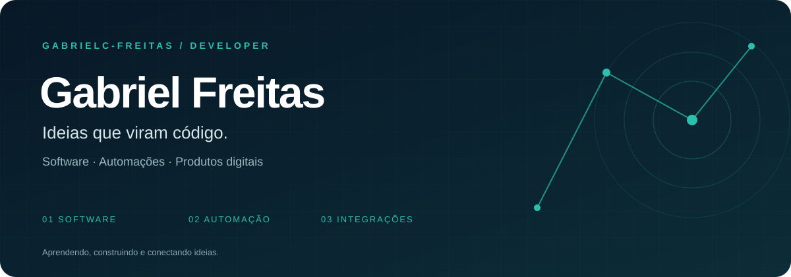

  

  <a href="https://www.linkedin.com/in/gabrielcastrofreitas/"><strong>LinkedIn</strong></a> &nbsp; / &nbsp;
  <a href="mailto:freitascastrogabriel@gmail.com"><strong>E-mail</strong></a> &nbsp; / &nbsp;
  <a href="https://github.com/GabrielC-Freitas?tab=repositories"><strong>Projetos</strong></a>

## Olá, sou o Gabriel 👋

Desenvolvo software, automações e integrações para transformar processos em soluções úteis. Gosto de conectar dados, simplificar operações e construir produtos digitais com atenção à experiência de quem usa.

Por aqui, compartilho projetos, experimentos e aprendizados. Da automação em Python às interfaces web, gosto de aprender construindo e encontrar formas mais simples de resolver problemas.

### O que construo

| Automações & dados | Sistemas & produtos | Integrações |
| :--- | :--- | :--- |
| Captura de informações, web scraping e organização de dados. | Aplicações web e ferramentas para tornar o dia a dia mais simples. | Conexões entre serviços, APIs e processos operacionais. |

### Tecnologias

**Python** · **JavaScript** · **C#** · **React** · **HTML** · **CSS**

### Projetos públicos

- **[Busca de placas](https://github.com/GabrielC-Freitas/busca_de_placas)**  
  Web scraping em Python para extrair e organizar informações.
- **[Gerenciamento de projetos e tarefas](https://github.com/GabrielC-Freitas/Aplica-o-React-de-Gerenciamento-de-Projetos-e-Tarefas)**  
  Aplicação construída com React e Material UI.
- **[FreeWay](https://github.com/GabrielC-Freitas/FreeWay)**  
  Recriação em JavaScript do clássico jogo de Atari.
- **[Pedra, papel e tesoura](https://github.com/GabrielC-Freitas/Jogo-de-Pedra-Papel-Tesoura)**  
  Um dos meus projetos de aprendizado com Python.

### Vamos conversar?

Para trocar ideias sobre tecnologia, automações ou um novo produto:

**[freitascastrogabriel@gmail.com](mailto:freitascastrogabriel@gmail.com)**  
[LinkedIn](https://www.linkedin.com/in/gabrielcastrofreitas/) · [Instagram](https://instagram.com/gabriel_freitas_c)

Além do código

[YouTube](https://www.youtube.com/channel/UCzc8auelC4ztS8-JfkxdVMg) · [Twitch](https://www.twitch.tv/gabenervous)

---

Aprendendo, construindo e conectando ideias.

